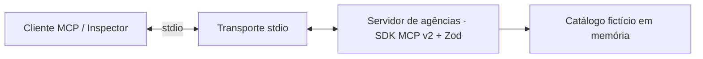

<a id="topo"></a>
<div align="center">

<h1>MCP Gateway Lab</h1>

<p>Do primeiro servidor MCP a um gateway em TypeScript inspirado na arquitetura da Uber.</p>
<p><strong>Projeto autoral de estudo · Em fase de desenvolvimento</strong></p>

<p>


<a href="LICENSE"></a>
</p>

<p><a href="#comece-aqui">Comece aqui</a> · <a href="#arquitetura-atual">Arquitetura atual</a> · <a href="#trilha-de-implementacao">Trilha de implementação</a> · <a href="#sobre-mim">Sobre mim</a></p>
</div>

---

> [!NOTE]
> **Tutorial em breve.** Vou publicar um guia explicando as decisões de arquitetura, por que tomei cada uma delas e como implementar o laboratório passo a passo, do primeiro servidor MCP ao gateway em TypeScript.

## De onde vem a ideia

O time de engenharia da Uber descreveu como centralizou a descoberta, a governança e a execução de ferramentas MCP usadas por agentes. O **MCP Registry** organiza o catálogo e a habilitação de ferramentas no plano de controle. O **Proxy Gateway** encaminha as chamadas aos serviços de destino no plano de dados. [Uber Engineering · Designing MCP Gateway](https://www.uber.com/au/en/blog/designing-mcp-gateway/)

Este laboratório recria em pequena escala as ideias publicadas no artigo, com código autoral e um banco fictício como cenário. O objetivo é entender, etapa por etapa, como um gateway pode expor ferramentas a clientes MCP e atuar como cliente dos servidores de destino. O projeto é independente da Uber e roda localmente com dados fictícios, sem chaves de API ou acesso a serviços bancários.

## Comece aqui

Use **Node.js 24**, npm e Git. Na raiz do projeto, execute:

```sh
git clone https://github.com/glaucia86/mcp-gateway-typescript.git
cd mcp-gateway-typescript
npm ci
npm run dev
```

O último comando imprime o estado `bootstrap` no terminal e encerra. Se o PowerShell bloquear `npm.ps1`, use `npm.cmd` e `npx.cmd` no lugar de `npm` e `npx`.

### Experimente o servidor MCP

O MCP Inspector inicia o servidor como subprocesso e permite descobrir e chamar ferramentas sem um LLM. Para usar o Inspector com Node.js 24, instale a versão **24.22.1 ou superior**. [Documentação do MCP Inspector](https://modelcontextprotocol.io/docs/tools/inspector)

```sh
npx --yes @modelcontextprotocol/inspector node --import tsx src/mcp/branches-stdio.ts
```

No navegador, conecte-se ao servidor, abra a aba **Tools** e experimente as chamadas abaixo.

| Ferramenta | Argumentos | Resultado esperado |
| --- | --- | --- |
| `list_branches` | `{}` | Três agências fictícias |
| `list_branches` | `{"city":"Rio de Janeiro"}` | Duas agências no Rio de Janeiro |
| `get_branch` | `{"id":"AG-002"}` | Agência Barra |
| `get_branch` | `{"id":"AG-999"}` | Erro de ferramenta, pois a agência não existe |
| `list_cities` | `{}` | Rio de Janeiro e São Paulo |

### Comandos

| Comando | O que faz |
| --- | --- |
| `npm run dev` | Exibe o estado do bootstrap e encerra |
| `npm run mcp:branches` | Inicia o servidor de agências e aguarda um cliente via `stdio` |
| `npm run typecheck` | Verifica os tipos TypeScript |
| `npm test` | Executa os testes do catálogo e do bootstrap com Vitest |

## Arquitetura atual



- [Transporte `stdio`](src/mcp/branches-stdio.ts) mantém as mensagens do protocolo em `stdout` e os diagnósticos em `stderr`.
- [Servidor MCP](src/mcp/branches-server.ts) registra as três ferramentas e valida os argumentos com Zod.
- [Domínio de agências](src/domain/branches.ts) concentra as consultas ao catálogo em memória e é independente do MCP.

<a id="trilha-de-implementacao"></a>

## Trilha de implementação

| Etapa | O que o laboratório exercita | Estado |
| --- | --- | --- |
| 1 · Fundamentos e ambiente | Bootstrap, TypeScript e testes | Implementada |
| 2 · Primeiro servidor MCP | Catálogo de agências, ferramentas com Zod e transporte `stdio` | Implementada |
| 3 · Cliente e segundo servidor | Conectar uma aplicação TypeScript aos servidores de agências e de chamados fictícios, com um cliente MCP por servidor | Próxima etapa |
| 4 · Registry | Cadastrar ferramentas e exigir aprovação explícita para habilitá-las | Planejada |
| 5 · Proxy Gateway | Encaminhar chamadas ao servidor certo e negar acesso por padrão | Planejada |
| 6 em diante · Descoberta e governança | Descoberta incremental inspirada no Omni MCP, auditoria, mascaramento de dados, limites de chamadas e aprovação humana para operações simuladas | Planejada |

Nesta etapa, você já pode se conectar diretamente ao servidor de agências.

## Licença

Projeto de estudo de Glaucia Lemos, sob a [licença MIT](LICENSE).

---

<a id="sobre-mim"></a>

## 👩🏽‍💻 Sobre mim

<div align="center">
<a href="https://github.com/glaucia86"></a>

<h3>Glaucia Lemos</h3>
<p><strong>Software Engineer · Microsoft MVP · Codex &amp; Devin Ambassador</strong></p>
<p>Trabalho com engenharia de IA e arquitetura de software. Compartilho o que aprendo sobre TypeScript & Python MCP e aplicações com agentes em tutoriais, workshops e projetos de código aberto.</p>

<p>
<a href="https://www.youtube.com/user/l32759"></a>
<a href="https://www.linkedin.com/in/glaucialemos/"></a>
<a href="https://github.com/glaucia86"></a>
</p>
<p><a href="#topo">↑ Voltar ao topo</a></p>
</div>
